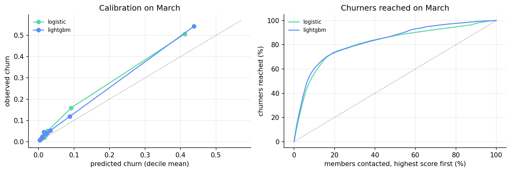
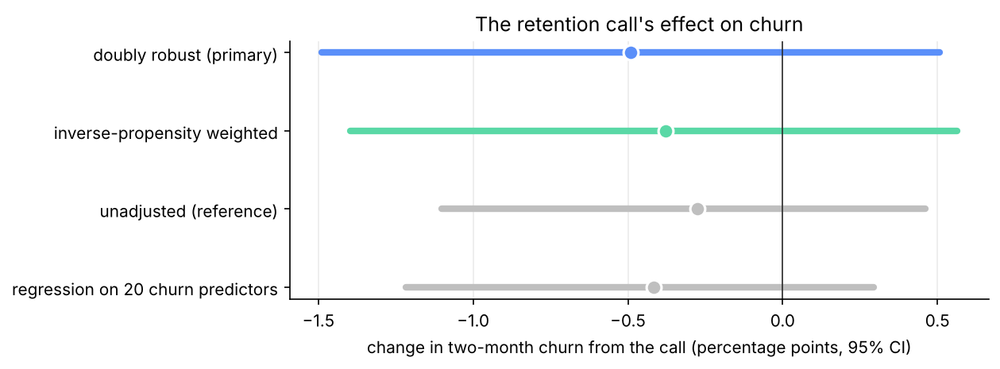

# 💸 Churn and retention on real data


> Who will churn, what are they worth, and is a retention offer worth making? A churn model on
> 2 million real KKBox subscriptions, tested on a later month; lifetime value from 3 million real
> subscription spells; and the effect of a real randomized retention campaign, read honestly.
> Analysis plans were committed before the data was downloaded.

## TL;DR

| Question | Answer |
|---|---|
| **Who will churn next month?** (KKBox, trained on February 2017, tested once on March) | LightGBM reaches **PR-AUC 0.594** against a 9.0% base rate; its top 10% of scores hold **60%** of the members who churned. Auto-renew and recent cancellations carry most of the signal; listening adds little. |
| **Does a retention call keep customers?** (telecom, 11,896 high-risk customers) | **No detectable effect:** −0.49 points of churn (95% CI −1.49 to +0.51). And the "randomized" campaign wasn't randomized the same way for everyone (a model predicts who was called, AUC **0.64**), which the dataset's own check missed. |
| **Should KKBox offer a free month?** | Not yet. At the best estimate it pays for about 11,000 of 971,000 members a month, but the evidence includes no effect at all. A test needs only **256** members per arm among the 33,000 highest-risk members. |



**Start here:** the [decision memo](./reports/decision_memo.md), then
[notebook 02](./notebooks/02_kkbox_churn_model.ipynb) (the model) and
[notebook 05](./notebooks/05_campaign_effect.ipynb) (the experiment).

---

## The retention workflow, and where each step is

| Step | Where |
|---|---|
| **1. Plan before the data:** cohorts, cutoffs, metrics, which model ships | [`reports/kkbox_analysis_plan.md`](./reports/kkbox_analysis_plan.md), [`reports/telecom_analysis_plan.md`](./reports/telecom_analysis_plan.md) |
| **2. Trust the data:** rebuild the churn label, prove no future data leaks in | [Notebook 01](./notebooks/01_kkbox_data_checks.ipynb) |
| **3. Predict churn out of time:** train February, test March once; calibration, lift | [Notebook 02](./notebooks/02_kkbox_churn_model.ipynb) |
| **4. Test a new data source:** do listening logs add anything? | [Notebook 03](./notebooks/03_kkbox_listening.ipynb) |
| **5. Value each member:** survival curves and lifetime value from payments | [Notebook 04](./notebooks/04_kkbox_lifetime_value.ipynb) |
| **6. Measure the intervention:** randomization check, propensity weighting, doubly robust effect | [Notebook 05](./notebooks/05_campaign_effect.ipynb) |
| **7. Target it:** churn risk vs uplift models, judged on held-out customers | [Notebook 06](./notebooks/06_campaign_targeting.ipynb) |
| **8. Decide:** expected value per member, break-even effect, the test to run | [Notebook 07](./notebooks/07_retention_decision.ipynb) |

## Part 1 · KKBox: who will churn, and what are they worth?

KKBox, a Taiwanese music-streaming service, released 22 million payments and churn labels for
members whose subscription expired in February and March 2017 (Kaggle, WSDM 2018).

| Notebook | What it answers |
|---|---|
| [01 · Data checks](./notebooks/01_kkbox_data_checks.ipynb) | The churn label rebuilt from payments agrees 97.6%; features use no data after the cutoff (the check caught a tie-break bug). |
| [02 · Churn model](./notebooks/02_kkbox_churn_model.ipynb) | Rule vs logistic regression vs LightGBM, trained on February and tested once on March; LightGBM ships (+0.088 PR-AUC, CI excludes zero); calibration drifts as churn rises from 6.4% to 9.0%. |
| [03 · Listening](./notebooks/03_kkbox_listening.ipynb) | Listening in the 14 days before expiry adds +0.011 PR-AUC: payments carry the signal. |
| [04 · Lifetime value](./notebooks/04_kkbox_lifetime_value.ipynb) | Kaplan–Meier survival by plan and auto-renew; a March member is worth NT$687 of margin over 24 months. |

## Part 2 · A real retention campaign: did the call work?

A Belgian telecom operator held back a random-looking 24% of 11,896 high-risk customers and called
the rest with a retention offer (Verhelst et al. 2023, OpenML 45580).

| Notebook | What it answers |
|---|---|
| [05 · Effect](./notebooks/05_campaign_effect.ipynb) | The randomization check fails, so the plan switches to propensity weighting and a doubly robust estimate: no detectable effect. |
| [06 · Targeting](./notebooks/06_campaign_targeting.ipynb) | Churn risk, T-learner and X-learner rankings, propensity-weighted Qini with bootstrap intervals: none beats random. |



## Part 3 · The decision

[Notebook 07](./notebooks/07_retention_decision.ipynb) combines each member's churn probability
and value with the campaign's effect and its interval: expected value per member, break-even
effect, and the size of the test that would settle it.

## Appendix · StreamFlix: the full workflow on simulated data

The project's first version, kept whole: a simulated subscription business with planted effects,
analysed through eleven notebooks (EDA, survival, calibrated churn model, SHAP, fairness audit,
budget-constrained policy, randomized holdout, uplift models), with its own demo app. Because the
true effects are known, it shows the methods recover them. See
[`notebooks/streamflix/README.md`](./notebooks/streamflix/README.md).

---

## Reproduce

```bash
pip install -r requirements.txt
pytest                                    # methods on known answers, reported numbers, apps
```

Neither dataset can be redistributed, so without them every notebook runs on a synthetic stand-in
(that is what CI does). To run on the real data, follow [`data/README.md`](./data/README.md):
download KKBox from Kaggle and the telecom file from OpenML, run
`python scripts/convert_kkbox.py`, then `python scripts/build_notebooks.py --execute` and
`python scripts/check_metrics.py`.

## Interactive demo

[janeruxi1-streamflix-churn-retention.streamlit.app](https://janeruxi1-streamflix-churn-retention.streamlit.app/)
(`streamlit run app/streamlit_app.py` locally). Two pages: **real data** (the churn model's
results, the retention experiment, and the offer decision with its assumptions as sliders) and the
**StreamFlix case study** from the project's first version.

## Limits

- KKBox data is from 2015–2017, and the 30% margin and 24-month horizon are assumptions.
- The telecom effect assumes the customer features capture whatever decided who was held back,
  and carrying a telecom call's effect to a music-service offer is an assumption, which is why
  the recommendation is a KKBox test.

## Related work

[`ab-testing-real-experiments`](https://github.com/janeruxi1/ab-testing-real-experiments) and
[`StreamFlix-RAG-evaluation`](https://github.com/janeruxi1/StreamFlix-RAG-evaluation).

## Author

Xi Ru · [LinkedIn](https://www.linkedin.com/in/xiru) · [Email](mailto:ruthruxi@gmail.com)
