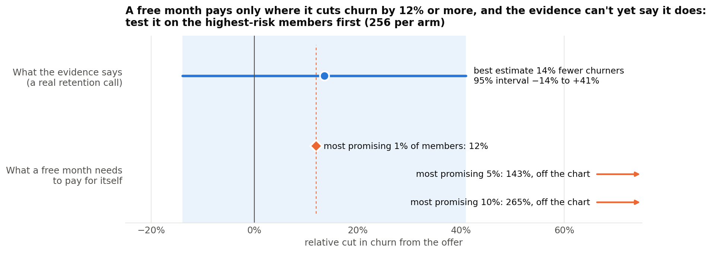
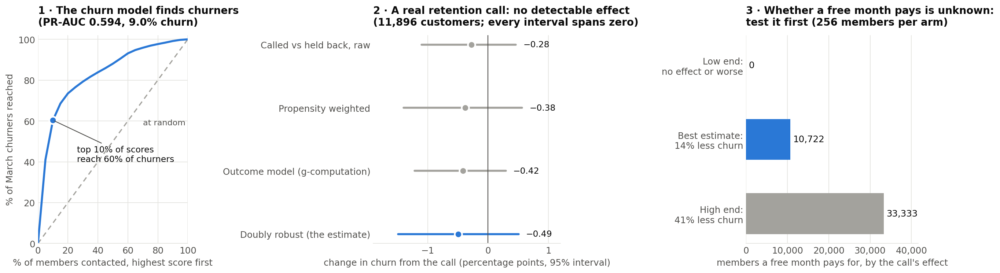
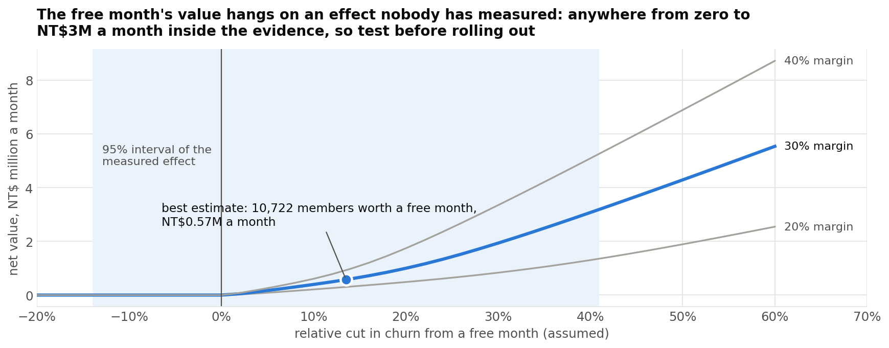
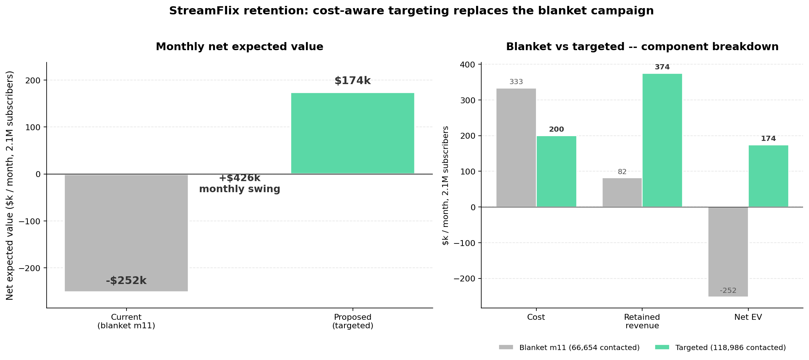

# Churn and Retention on Real Data

[](https://github.com/janeruxi1/churn-uplift-decisioning/actions)

[](https://janeruxi1-churn-uplift-decisioning.streamlit.app/)

**[Decision memo](./reports/decision_memo.md)** · **[Live demo](https://janeruxi1-churn-uplift-decisioning.streamlit.app/)** · **[Notebooks](./notebooks/README.md)**

Who will churn, what are they worth, and is a retention offer worth making? A churn model on 2 million
real KKBox music subscriptions, tested on a later month; lifetime value from their payments; and the
effect of a real retention campaign at a telecom operator. Analysis plans were committed before the data
was downloaded, and CI checks every number below against the recorded results.

## Key results

- **The churn model finds churners.** Trained on February and tested once on March, LightGBM reaches
  PR-AUC 0.594 against a 9.0% churn rate; contacting its top 10% of scores reaches **60%** of churners.
  Auto-renew status, payment method and plan price carry most of the signal; listening adds +0.011.
- **The retention call has no detectable effect:** −0.49 points of churn (95% CI −1.49 to +0.51) for
  11,896 high-risk customers. The "randomized" hold-out wasn't random (a model predicts who was called,
  AUC **0.64**), so the estimate uses propensity weighting and a doubly robust model.
- **Don't roll out a free month yet; test it.** At the best estimate it pays for about 11,000 of 971,000
  members a month, but the evidence includes no effect at all. A test needs only **256** members per arm
  among the 33,000 highest-risk members.



*Top: the measured effect of a real retention call on churn, with its 95% interval. Bottom: the cut in churn
a free month needs to pay for itself, for the KKBox members where it is easiest. Only the most promising 1%
fall inside the evidence, so the recommendation is a small test, not a rollout. Drawn from the recorded
results by `scripts/make_readme_figure.py`.*

## How it works

| Step | Method | Where |
|---|---|---|
| Plan | Cohorts, cutoffs, metrics and which model ships, fixed before the data | [KKBox plan](./reports/kkbox_analysis_plan.md) · [telecom plan](./reports/telecom_analysis_plan.md) |
| Trust the data | Churn label rebuilt from payments (agrees 97.6%); a test that no feature uses data after the cutoff | [01](./notebooks/01_kkbox_data_checks.ipynb) |
| Predict churn | Rule vs logistic regression vs LightGBM, out of time; LightGBM ships (+0.092 PR-AUC, CI excludes zero); calibration, SHAP, segment and drift checks; runs tracked in MLflow | [02](./notebooks/02_kkbox_churn_model.ipynb) |
| New data source | Do listening logs add anything beyond payments? | [03](./notebooks/03_kkbox_listening.ipynb) |
| Value each member | Kaplan–Meier survival; NT$687 of margin per member over 24 months | [04](./notebooks/04_kkbox_lifetime_value.ipynb) |
| Measure the call | Randomization check, propensity weighting, doubly robust effect, E-values for hidden confounding | [05](./notebooks/05_campaign_effect.ipynb) |
| Target it | Churn risk vs T- and X-learner uplift, judged by Qini on held-out customers | [06](./notebooks/06_campaign_targeting.ipynb) |
| Decide | Expected value per member, break-even effect, the test that would settle it | [07](./notebooks/07_retention_decision.ipynb) |



*The three questions in order. Left: churners reached as more members are contacted, highest score first
(churn rose from 6.4% in February to 9.0% in March, which the model under-predicts). Middle: four estimates
of the call's effect; every interval spans zero. Right: how many members a free month pays for at the low,
best and high estimate of the effect.*



*Why test before rolling out: the offer's monthly value at each possible effect, for three margin
assumptions. Inside the measured interval (shaded) it is anywhere from zero to about NT$3M a month.*

## Appendix · StreamFlix: the full workflow on simulated data

The project's first version: a simulated subscription business (2.1M subscribers, synthetic, with planted
effects) analysed through eleven notebooks, from EDA and survival to a calibrated churn model, SHAP,
a fairness audit, a budget-constrained decision rule and uplift models.

- **Replace the blanket month-11 credit with cost-aware targeting:** spending $200k instead of $333k a
  month, net expected value goes from **−$252k** to **+$174k** (ROI 0.25× → 1.87×), a +$426k monthly swing.
- **The churn model ranks well enough to target:** PR-AUC 0.177 against a 0.053 base rate; the riskiest 10%
  hold 35% of churners. It under-predicts the month-12 anniversary spike, a fix before launch.
- **An uplift model was tested, not assumed, and shelved:** the $5-credit experiment confirms the average
  effect (12.6% of would-be churners retained), but every uplift learner ranks users no better than chance.



[StreamFlix memo](./reports/streamflix/decision_memo.md) · [StreamFlix notebooks](./notebooks/streamflix/README.md) · [Details](./docs/streamflix_details.md)

## Data

- **KKBox** (Kaggle, WSDM 2018): 22 million payments and churn labels for members whose subscription
  expired in February or March 2017. Not redistributed.
- **Telecom retention campaign** (Verhelst et al. 2023, OpenML 45580): 11,896 high-risk customers, 24% held back.
- **StreamFlix** (appendix): synthetic, with planted effects; it has its own page in the demo.

Download steps are in [`data/README.md`](./data/README.md). Without the data every notebook runs on a
synthetic stand-in, which is what CI does.

## Limits

- KKBox data is from 2015–2017; the 30% margin and 24-month horizon are assumptions.
- The telecom effect assumes the customer features capture whatever decided who was held back.
- Carrying a telecom call's effect to a music-service offer is an assumption, which is why the
  recommendation is a KKBox test rather than a rollout.

<details>
<summary><b>Run it</b></summary>

```bash
pip install -r requirements.txt
pytest                                               # methods on known answers, reported numbers, apps
python scripts/convert_kkbox.py                      # after downloading the data (data/README.md)
python scripts/build_notebooks.py --execute          # rebuild every notebook with outputs
python scripts/check_metrics.py                      # compare the new records with the committed ones
mlflow ui --backend-store-uri sqlite:///mlflow.db    # browse tracked runs; model kkbox_churn@production
streamlit run app/streamlit_app.py                   # the demo
```

</details>

<details>
<summary><b>Repository layout</b></summary>

```
reports/decision_memo.md      the recommendation (start here)
reports/*_analysis_plan.md    plans committed before the data
reports/metrics/              every recorded result (JSON); reports/figures/
notebooks/01-07_*             .py source + executed .ipynb; notebooks/streamflix/ = appendix
src/                          churn features and models, survival, causal effect, uplift, MLflow tracking
app/                          the demo (real data + StreamFlix pages)
tests/                        methods, known-answer checks, doc numbers vs records
```

</details>

**Related:** [A/B testing on real experiments](https://github.com/janeruxi1/ab-testing-real-experiments) ·
[Card fraud decisioning](https://github.com/janeruxi1/card-fraud-decisioning) ·
[All projects](https://github.com/janeruxi1)

Xi Ru · [LinkedIn](https://www.linkedin.com/in/xiru) · [Email](mailto:ruthruxi@gmail.com)
